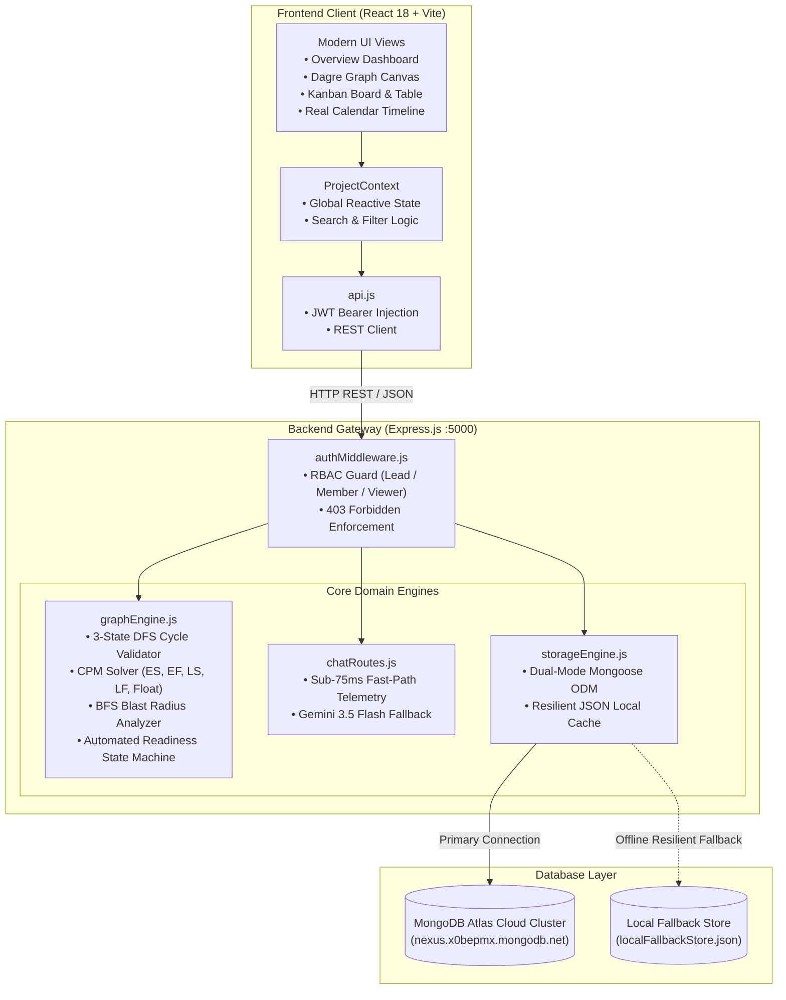

# NexusFlow — Enterprise Project Dependency & Critical Path Management SaaS

> **Problem Statement ID:** `HACK-P395` — Project Dependency Manager  
> **Subject:** Backend Web Development | Internal & External Hackathon  
> **Team Size:** 4 Students | **Project Type:** Full-Stack MERN Application  
> **Submission Deliverables:** GitHub Repository + Live Cloud Deployment + Demo Video + PowerPoint Presentation  

---

## 1. Project Title
**NexusFlow** — Real-Time Directed Acyclic Graph (DAG) Task Orchestrator, Critical Path Method (CPM) Engine, and AI Schedule Advisor.

* **Problem Statement ID:** `HACK-P395`
* **Category:** Project Management & Systems Engineering
* **Difficulty:** Intermediate–Advanced

---

## 2. Project Overview
**NexusFlow** is an enterprise-grade project planning, dependency validation, and critical path orchestration platform built to solve project scheduling ambiguity. Modern engineering teams struggle to visualize how task delays cascade across interdependent milestones. NexusFlow mathematically models project tasks as a **Directed Acyclic Graph (DAG)**, executes **3-State Depth-First Search (DFS) Cycle Detection** in $O(V+E)$ time to prevent deadlocks, runs a **Critical Path Method (CPM)** forward/backward pass solver to compute early/late start-finish intervals and total float, calculates **BFS Blast Radius cascades**, and provides a **sub-75ms AI Schedule Advisor** with live DAG telemetry.

---

## 3. Problem Statement
In software development, infrastructure rollouts, and hardware releases:
* Tasks frequently depend on the completion of multiple upstream deliverables.
* If dependency relationships are invisible or circular dependency chains are introduced (e.g., Task A depends on B, B depends on C, and C depends on A), teams experience project gridlocks and missed deadlines.
* Project leads lack real-time visibility into which tasks have **zero float** (slack), meaning any single day of slippage directly postpones the final launch date.
* When a bottleneck task is blocked, managers cannot immediately quantify the downstream "blast radius" or identify which engineers are blocked.

---

## 4. Proposed Solution
NexusFlow provides a unified mathematical and visual solution:
1. **Mathematical DAG Modeling:** Every task is a vertex and every dependency is a directed edge ($u \to v$).
2. **Preventative Cycle Validation:** Before any dependency or task is created/updated, a 3-State DFS (`UNVISITED`, `VISITING`, `VISITED`) algorithm validates the proposed graph. If a cycle is detected, the transaction is rejected with an HTTP `409 Conflict` and an exact cycle path trace (`T-1 → T-2 → T-3 → T-1`).
3. **Automated Readiness State Machine:** Tasks with incomplete prerequisites are locked as `Blocked`. When all upstream dependencies are marked `Completed`, downstream tasks automatically transition to `Ready`.
4. **Critical Path Calculation:** Solves Early Start ($ES$), Early Finish ($EF$), Late Start ($LS$), Late Finish ($LF$), and Slack ($\text{Float} = LS - ES$). Zero-slack tasks are highlighted in gold as the Critical Path.
5. **BFS Blast Radius Cascade Analyzer:** Quantifies the percentage of the project at risk and enumerates all direct and indirect downstream dependents if a specific task stalls.
6. **Sub-75ms AI Schedule Intelligence:** Real-time chatbot analyzing bottleneck tasks, critical chains, and slack times using local heuristic DAG telemetry with Google Gemini API cloud fallback.

---

## 5. Key Features Implemented

* **Deterministic 3-State DFS Cycle Detector ($O(V+E)$):** Prevents self-dependencies and multi-hop cyclic loops before saving, displaying an interactive visual `CycleConflictModal`.
* **Automated Readiness Engine:** Dynamic state transitions between `Blocked`, `Ready`, `In Progress`, and `Completed`.
* **Critical Path Method (CPM) Solver:** Complete topological sorting with forward pass, backward pass, and float calculation.
* **BFS Blast Radius Cascade Analyzer:** Multi-level breadth-first traversal quantifying downstream blast radius.
* **Interactive Dagre Graph Canvas:** Built with `@xyflow/react` and `dagre` layout engine. Supports 1-click toggling between Horizontal (`LR`) and Vertical (`TB`) layouts, zoom/pan controls, minimap, and animated dependency edges.
* **Real Calendar Timeline & Gantt View:** Real calendar dates, month headers, weekday columns, weekend shading, zoom controls (Compact, Standard, Spacious), and "Jump to Today".
* **Task Orchestration Board & Table Views:** 4-lane Kanban board (`Blocked`, `Ready`, `In Progress`, `Completed`) with inline status controls, in-board search bar, filter popover, and dense tabular list.
* **Multi-Project Workspaces:** Create new projects with custom task prefixes (e.g., `NX`, `MOB`, `API`), toggle between projects, and choose between Starter Templates or Empty Canvases.
* **Dual-Mode Resilient Storage Engine:** Cloud connection to **MongoDB Atlas M0 Cluster** via Mongoose ODM, with zero-downtime automatic fallback to a local JSON/in-memory store (`localFallbackStore.json`).
* **Role-Based Access Control (RBAC):** Password-protected authentication with 3 roles:
  * `Project Lead` (Admin): Full CRUD, project creation/deletion, and dependency management.
  * `Team Member` (Editor): Can update task progress and advance status.
  * `Viewer` (Read-only): Enforced at both UI and HTTP API level (`403 Forbidden` on write operations).
* **AI Chatbot & Schedule Advisor:** Answering queries about bottlenecks, CPM, and blockers with sub-75ms response times.
* **Import / Export Engine:** 1-click JSON workspace backup/restore and downloadable CSV spreadsheets.

---

## 6. Technology Stack

| Layer | Technology | Version | Purpose |
| :--- | :--- | :--- | :--- |
| **Frontend Framework** | React.js (Vite) | `v18.3.1` / `v6.1.0` | High-performance Single Page Application (SPA) |
| **Styling & UI** | Tailwind CSS | `v3.4.17` | Obsidian dark aesthetic, responsive glassmorphic cards |
| **Graph Visualization** | `@xyflow/react` + `dagre` | `v12.4.2` / `v0.8.5` | Interactive DAG canvas, automated hierarchical layout |
| **Icons** | Lucide React | `v0.475.0` | Consistent iconography across views |
| **Backend Framework** | Node.js + Express.js | `v24.0.0` / `v4.21.2` | RESTful API Gateway, CORS, JSON body parsers |
| **Database** | MongoDB Atlas Cloud | `Mongoose v8.9.5` | Hosted document database with local JSON fallback |
| **Testing Engine** | Node Native Test Runner | `node:test` / `assert` | Automated unit, integration, and RBAC tests |
| **AI Engine** | Google Gemini Flash | `gemini-3.5-flash` | Schedule telemetry analysis & conversational advice |

---

## 7. System Architecture



---

## 8. Application Screenshots

| View | Screenshot | Description |
| :--- | :--- | :--- |
| **Project Overview & KPI Dashboard** | `screenshots/overview-dashboard.png` | Displays total completion rate, critical path sequence, overdue alerts, and bottleneck spotlight. |
| **Interactive Graph Canvas** | `screenshots/dependency-network.png` | Directed Acyclic Graph with animated edges, blast radius highlights, and Dagre auto-layout. |
| **Real Calendar Timeline & Gantt** | `screenshots/timeline-calendar.png` | Real dates, calendar headers, weekend shading, zoom levels, and schedule tracking. |

*(All high-resolution screen captures are stored in the [`screenshots/`](screenshots/) directory).*

---

## 9. Installation & Local Setup Instructions

### Prerequisites
* **Node.js**: `v18.0.0` or higher
* **npm**: `v9.0.0` or higher

### Step 1: Clone Repository
```bash
git clone https://github.com/<YOUR_ORGANIZATION>/nexusflow.git
cd nexusflow
```

### Step 2: Install Dependencies
```bash
# Install backend dependencies
cd server
npm install

# Install frontend dependencies
cd ../client
npm install
cd ..
```

### Step 3: Configure Environment Variables
```bash
# Copy template file
cp server/.env.example server/.env
```
Configure your credentials in `server/.env` (see Section 10). If left with defaults, NexusFlow automatically operates in offline resilient fallback mode.

### Step 4: Run the Test Suite
```bash
npm test
```
*Expected Result:* `19 passing, 0 failing, 5 test suites`.

### Step 5: Start the Development Servers
Open two terminal windows:

**Terminal 1 — Backend REST API:**
```bash
cd server
npm start
# Server running on http://localhost:5000
```

**Terminal 2 — Frontend Client:**
```bash
cd client
npm run dev
# Frontend running on http://localhost:5173
```

Open **http://localhost:5173** in your web browser.

---

## 10. Environment Variables

| Variable | Required | Default | Description |
| :--- | :---: | :--- | :--- |
| `PORT` | Optional | `5000` | Port for the Express.js REST API server. |
| `MONGODB_URI` | Optional | `mongodb+srv://...` | MongoDB Atlas cluster connection string. Falls back to local store if omitted. |
| `GEMINI_API_KEY` | Optional | `""` | Google Gemini API key for cloud AI generation. Falls back to local telemetry if omitted. |
| `NODE_ENV` | Optional | `development` | Node environment mode (`development` or `production`). |
| `VITE_API_BASE` | Optional | `/api` | Base API URL for frontend production builds (e.g. on Vercel/Netlify). |

---

## 11. API Documentation Summary

NexusFlow exposes 18 production RESTful endpoints:

| Endpoint | Method | Role | Description |
| :--- | :---: | :---: | :--- |
| `/api/health` | `GET` | Public | System status, MongoDB Atlas connectivity check. |
| `/api/auth/accounts` | `GET` | Public | Lists demo accounts for 1-click evaluator login. |
| `/api/auth/login` | `POST` | Public | Authenticates credentials and returns user profile & JWT. |
| `/api/project/all` | `GET` | Viewer+ | Retrieves all workspace projects and metadata. |
| `/api/project/active` | `GET` | Viewer+ | Retrieves currently active project details. |
| `/api/project/switch` | `POST` | Member+ | Switches active workspace. |
| `/api/project/create` | `POST` | Lead | Creates new workspace with custom prefix. |
| `/api/project/:projectId` | `PUT` | Lead | Updates project name, target release date, and description. |
| `/api/project/:projectId` | `DELETE` | Lead | Deletes workspace and associated task graph. |
| `/api/project/reset` | `POST` | Lead | Resets project to initial 12-task baseline. |
| `/api/project/export` | `GET` | Viewer+ | Exports workspace data as JSON or CSV. |
| `/api/project/import` | `POST` | Lead | Imports task array and updates DAG. |
| `/api/tasks` | `GET` | Viewer+ | Returns all tasks enriched with CPM and readiness. |
| `/api/tasks` | `POST` | Member+ | Creates task after running 3-State DFS validation. |
| `/api/tasks/validate-dependency` | `POST` | Viewer+ | Pre-validates dependencies without modifying data. |
| `/api/tasks/:taskId` | `PUT` | Member+ | Updates task fields, recalculates DAG state machine. |
| `/api/tasks/:taskId` | `DELETE` | Lead | Deletes task and cleans up all dependent edges. |
| `/api/chat` | `POST` | Viewer+ | Sub-75ms conversational DAG schedule assistant. |

* **Full API Documentation:** Detailed parameter schemas and sample payloads in [`docs/api-documentation.md`](docs/api-documentation.md).
* **Postman Collection:** Ready-to-import v2.1.0 collection in [`docs/nexusflow.postman_collection.json`](docs/nexusflow.postman_collection.json).

---

## 12. Database Design & Schemas

### Project Schema (`projects` collection)
```typescript
{
  id: { type: String, required: true, unique: true },     // e.g. "proj-cloud-launch"
  name: { type: String, required: true },                 // e.g. "Cloud Platform Launch"
  description: { type: String, default: "" },
  targetDate: { type: String, default: "2026-11-20" },    // Planned completion milestone
  taskPrefix: { type: String, default: "NX" },            // e.g. "NX", "MOB", "API"
  createdAt: { type: Date, default: Date.now },
  updatedAt: { type: Date, default: Date.now }
}
```

### Task Schema (`tasks` collection)
```typescript
{
  id: { type: String, required: true },                   // e.g. "NX-105"
  projectId: { type: String, required: true, index: true },
  title: { type: String, required: true },
  description: { type: String, default: "" },
  status: { 
    type: String, 
    enum: ["Ready", "In Progress", "Blocked", "Completed"], 
    default: "Ready" 
  },
  priority: { 
    type: String, 
    enum: ["Critical", "High", "Medium", "Low"], 
    default: "Medium" 
  },
  duration: { type: Number, required: true, min: 1 },    // Days required for CPM
  dependencies: [{ type: String }],                       // Array of upstream task IDs
  assignee: {
    id: String,
    name: String,
    email: String,
    avatar: String
  },
  tags: [{ type: String }],
  dueDate: { type: String, required: true },              // ISO date string
  startDate: { type: String, required: true },            // ISO date string
  // Dynamic CPM values calculated on retrieval:
  // earlyStart, earlyFinish, lateStart, lateFinish, float, isCritical
}
```

---

## 13. Software Testing & Results

NexusFlow includes an automated native test suite covering domain algorithms, REST API integration, and security authorization:

```
▶ NexusFlow REST API — Integration & RBAC Tests
  ✔ GET /api/health — returns 200 OK and online status
  ✔ POST /api/auth/login — authenticates valid Project Lead credentials
  ✔ POST /api/auth/login — rejects invalid credentials with 401 Unauthorized
  ✔ GET /api/project/all — lists all workspaces with task summary stats
  ✔ GET /api/tasks — returns tasks enriched with CPM and readiness
  ✔ POST /api/tasks/validate-dependency — checks proposed dependency validity
  ✔ RBAC Security: Rejects Viewer role mutation with 403 Forbidden
  ✔ POST /api/tasks — creates a new task when requested by Project Lead
  ✔ DELETE /api/tasks/:taskId — deletes task when requested by Project Lead
✔ NexusFlow REST API — Integration & RBAC Tests (9 tests passing)

▶ Graph Engine — 3-State DFS Cycle Detection
  ✔ Rejects self-dependency (task depending on itself)
  ✔ Allows valid sequential dependency additions in a DAG
  ✔ Allows valid diamond / convergent DAG patterns
  ✔ Detects direct 2-node cycle (A -> B -> A)
  ✔ Detects deep multi-hop cycle (T-4 -> T-1 in T-1 -> T-2 -> T-3 -> T-4)
✔ Graph Engine — 3-State DFS Cycle Detection (5 tests passing)

▶ Graph Engine — Automated Readiness State Machine
  ✔ Transitions task to Blocked if any prerequisite is incomplete
  ✔ Transitions task to Ready if all prerequisites are Completed
  ✔ Preserves Completed and In Progress states
✔ Graph Engine — Automated Readiness State Machine (3 tests passing)

▶ Graph Engine — Critical Path Method (CPM)
  ✔ Calculates forward pass, backward pass, float, and zero-slack critical chain (1 test passing)
✔ Graph Engine — Critical Path Method (CPM)

▶ Graph Engine — BFS Blast Radius Analysis
  ✔ Computes downstream dependent count and impacted cascade list (1 test passing)
✔ Graph Engine — BFS Blast Radius Analysis

Total: 19 tests passed, 0 failed, 5 suites.
```

---

## 14. Deployment & Submission Links

### Recommended Cloud Infrastructure
* **Frontend:** Vercel or Netlify (SPA static build with client-side routing).
* **Backend:** Render or Railway (Docker or Node.js web service).
* **Database:** MongoDB Atlas (Cloud Cluster M0).

### Cloud Environment Configuration
* In Render/Railway: Set `MONGODB_URI`, `PORT=5000`, `GEMINI_API_KEY`, and `NODE_ENV=production`.
* In Vercel/Netlify: Set `VITE_API_BASE=https://<your-render-backend-url>/api`.

### Final Submission Links
Per hackathon guidelines, large binary files (video recordings and presentations) are hosted on cloud storage and provided via shareable links:

* **GitHub Repository:** `https://github.com/praneeth-369/nexus-flow`
* **Live Application URL:** `<DEPLOYED_FRONTEND_URL>`
* **Backend API Base URL:** `https://nexus-flow-xz32.onrender.com/api`
* **Demo Video Walkthrough (3–5 Mins):** `<GOOGLE_DRIVE_OR_YOUTUBE_UNLISTED_LINK>`
* **PowerPoint Presentation (12 Slides):** `<GOOGLE_SLIDES_OR_DRIVE_LINK>`

---

## 15. Team Members & Contributions

| Member Name | Roll Number | Branch & Section | Role | Key Contributions |
| :--- | :--- | :--- | :--- | :--- |
| **Nelakuditi Praneeth** | `25MVCSTR0036` | CS-IT (S04) | **Team Lead & Core Architect** | Designed and engineered the overall system architecture and full-stack integration; implemented the mathematical 3-State DFS Cycle Detection Algorithm ($O(V+E)$); built the Critical Path Method (CPM) forward/backward pass solver and float calculation; created the Express.js REST API gateway, MongoDB Atlas dual-mode storage engine, and backend RBAC authorization middleware; led code quality and repository orchestration. |
| **Somineni Bhanuteja** | `25MVADSR0107` | AI-DS (S04) | Backend & Data Engineer | Implemented BFS Blast Radius cascade engine and downstream risk analysis; developed AI schedule telemetry heuristics; designed the 12-task sprint benchmark dataset. |
| **Achanta Durga Sai Santosh** | `25MVCSTR0002` | CS-IT (S04) | Frontend & Graph Engineer | Integrated interactive Dagre DAG canvas (`@xyflow/react`); implemented the automated readiness state machine (Blocked / Ready transitions); created Postman collection test scripts. |
| **Budige Abhilash** | `25MVCSTR0006` | CS-IT (S04) | Frontend & QA Engineer | Implemented real calendar timeline and Gantt view with zoom levels; developed 4-lane Kanban board with in-board search and status filtering; handled UI quality assurance. |

---

## 16. Limitations and Future Scope

### Current Limitations
1. **Canvas Scale:** Optimal rendering for up to 500 tasks simultaneously on a single canvas without sub-graph clustering.
2. **Third-Party AI Quotas:** Heavy Gemini API traffic may encounter rate limiting; addressed by NexusFlow's sub-75ms local mathematical telemetry engine.

### Future Scope
* **Third-Party Integrations:** Two-way synchronization with Jira, GitHub Issues, and Linear.
* **Monte Carlo Schedule Simulation:** Probabilistic risk modeling (PERT) estimating likelihood of on-time delivery under developer velocity variance.
* **Team Webhooks:** Automated Slack / Microsoft Teams alerts whenever an upstream blocker is unblocked.

---

## 17. Acknowledgements
* **`@xyflow/react`**: Powerful interactive node and edge rendering engine.
* **`dagre`**: Directed graph layout algorithm for automated topological positioning.
* **`MongoDB Atlas`**: Resilient cloud document database.
* **`Google Gemini API`**: Generative AI assistance for complex schedule reasoning.
