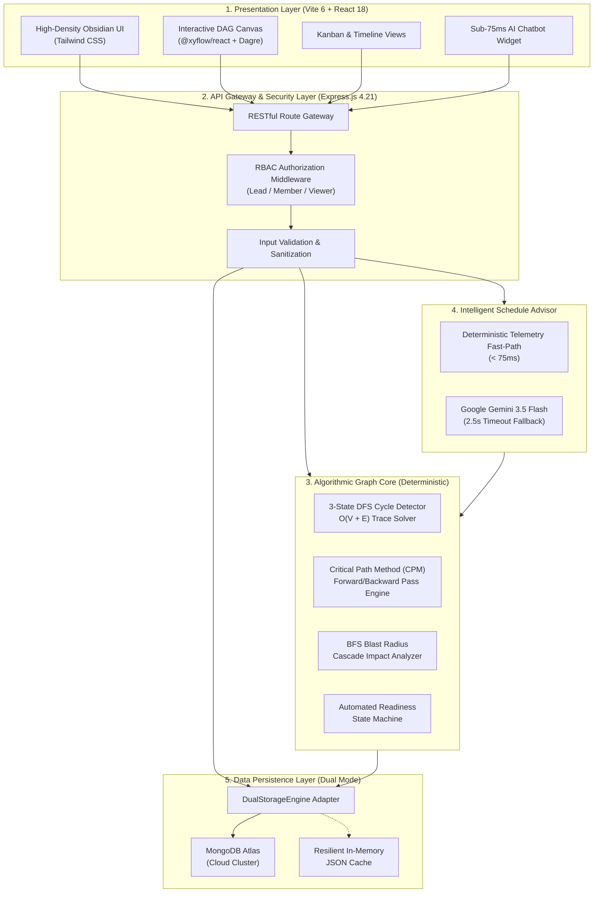
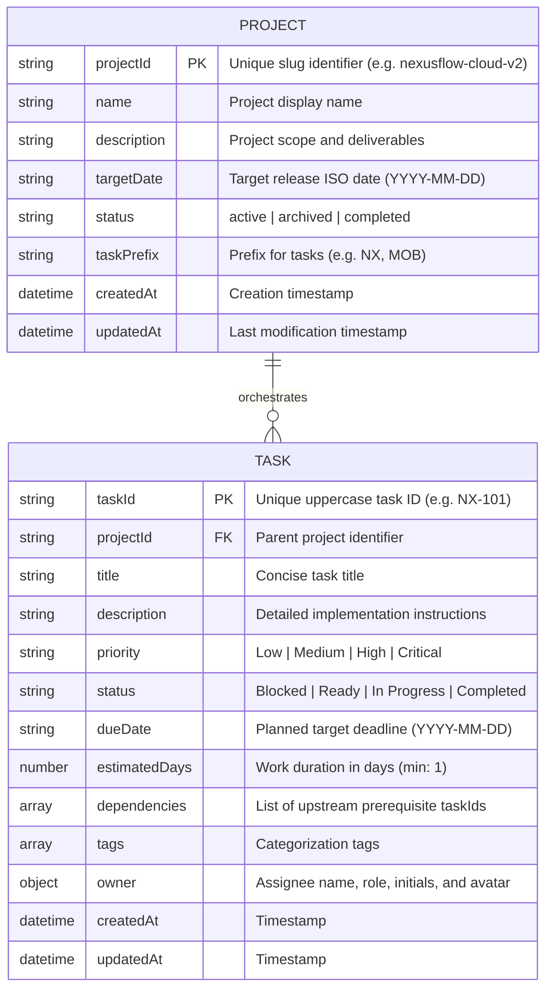

# NexusFlow System Architecture & Database Design

**Project:** NexusFlow (Problem Statement ID: `HACK-P395`)  
**Subject:** Backend Web Development  
**Architecture:** 3-Tier Layered Client-Server Architecture with Algorithmic Graph Core

---

## 1. High-Level System Architecture

---

## 2. Database Schema & Models (Mongoose / MongoDB)

### 2.1 Project Entity (`ProjectSchema`)

---

## 3. Algorithmic Graph Theory Specifications

### 3.1 3-State Depth-First Search (DFS) Cycle Detection

To guarantee that task dependencies form a strictly **Directed Acyclic Graph (DAG)** without deadlocks:
* Every node is tracked in one of three states:
  1. `UNVISITED (0)`: Node has not been touched in DFS traversal.
  2. `VISITING (1)`: Node is in the active recursion call stack.
  3. `VISITED (2)`: Node and all its downstream subtrees are verified acyclic.
* **Cycle Detection Rule:** If the traversal encounters a neighbor node with state `VISITING`, a circular dependency loop exists.
* **Path Reconstruction:** The algorithm backtracks the recursion call stack to return the exact circular sequence (e.g. `NX-102 → NX-105 → NX-108 → NX-102`) for visual conflict resolution.
* **Time Complexity:** $O(V + E)$ where $V$ is the number of tasks and $E$ is the number of dependency edges.

---

### 3.2 Critical Path Method (CPM) Forward & Backward Passes

The Critical Path represents the longest sequence of dependent activities that dictates the minimum possible project delivery duration:
1. **Topological Sort:** Order tasks so every prerequisite appears before its dependent tasks.
2. **Forward Pass (Early Dates):**
   $$ES(v) = \max_{u \in \text{Predecessors}(v)} (EF(u)), \quad ES(\text{root}) = 0$$
   $$EF(v) = ES(v) + \text{Duration}(v)$$
   $$\text{Project Duration} = \max_{v} (EF(v))$$
3. **Backward Pass (Late Dates):**
   $$LF(v) = \min_{w \in \text{Successors}(v)} (LS(w)), \quad LF(\text{terminal}) = \text{Project Duration}$$
   $$LS(v) = LF(v) - \text{Duration}(v)$$
4. **Total Float / Slack Calculation:**
   $$\text{Float}(v) = LS(v) - ES(v) = LF(v) - EF(v)$$
5. **Critical Chain Assembly:**
   $$\text{Critical Task} \iff \text{Float}(v) = 0$$

---

### 3.3 BFS Blast Radius & Cascade Impact Analysis

When a task is delayed or blocked, its downstream cascade impact is computed using **Breadth-First Search (BFS)** traversal:
* Traverses the reverse dependency graph from target task $T$.
* Identifies all direct dependents and recursive downstream milestones.
* Returns total affected count and percentage of project tasks impacted:
  $$\text{Blast Radius \%} = \left( \frac{\text{Impacted Tasks Count}}{\text{Total Project Tasks}} \right) \times 100$$
